# User Guide

---

## The Trace Window

The Trace window has four areas:

- **① Header** — the toolbar for saving, exporting, printing, and other actions. The counter next to **SLAC Trace** shows how many traces on the current plot use live and archive data.
- **② Layers** — the plot's axes and the traces on each axis. Click an item to edit it.
- **③ Plot area** — the plot itself, with plot tabs and view controls above it.
- **④ Properties** — settings for whatever is selected in **Layers**: the plot, an axis, or a trace.

  <a class="glightbox" href="../images/trace_window.png">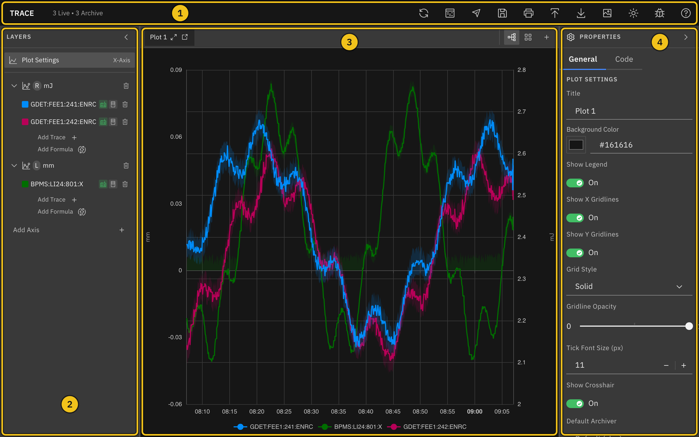</a>

### Resize and Collapse Panels

Drag the border between two panels to resize them. Click the chevron in the **Layers** or **Properties** header to collapse that panel to a thin strip, and click the strip to open it again. Useful when you want more room for the plot.

---

## Plot a PV

Every plot starts with one empty Y-axis. To plot a process variable (PV), add a trace to an axis and choose the PV it should follow. New traces show both archived and live data, so the plot fills the whole time range and keeps updating.

**Workflow:**

1. In the **Layers** panel on the left, click **Add Trace** under the axis you want to use (①). The new trace is selected, and its settings open in the **Properties** panel on the right.
2. Click the **PV Name** field and type part of the PV name (②). Matching PVs from the archiver appear in a list as you type.
3. Click the PV you want (③), or press **Enter** to use exactly what you typed.

  <a class="glightbox" href="../images/plot_pv_add_trace.png">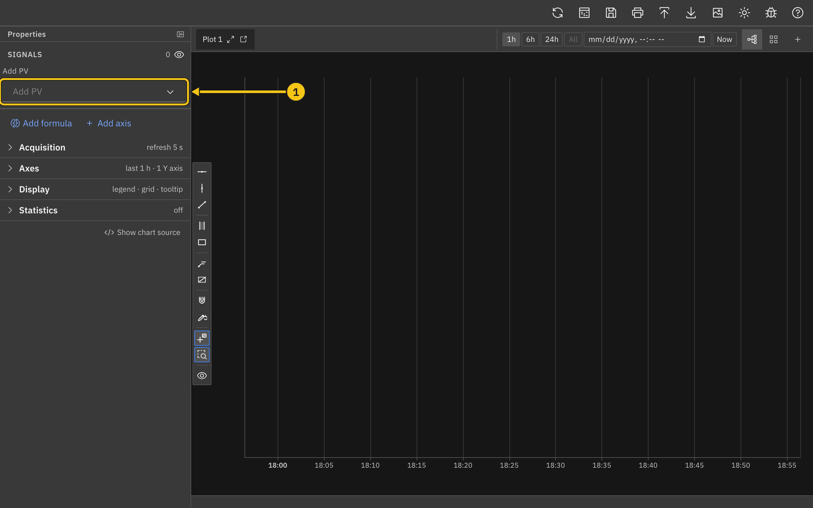</a>

  <a class="glightbox" href="../images/plot_pv_search.png">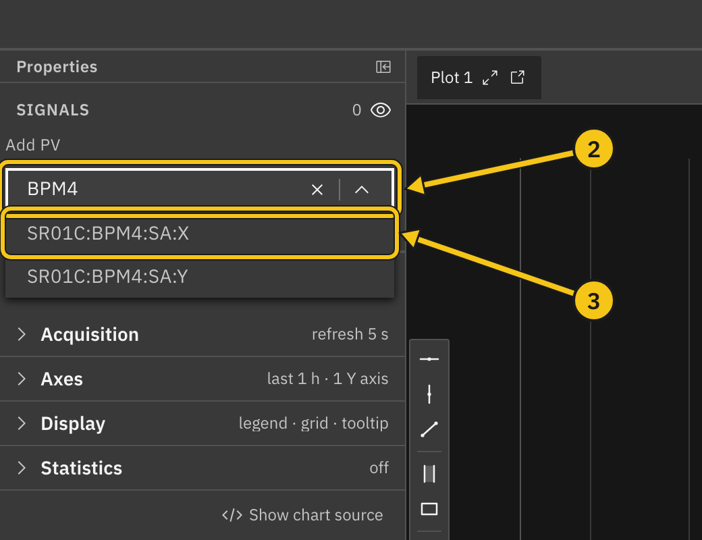</a>

Once you choose a PV, the trace starts drawing:

- **④ Layers** — the trace is listed under its axis, with icons showing that live and archive data are on. Click the row any time to edit the trace again.
- **⑤ Units axis** — the trace moves to an axis named after the PV's units (here **mJ**). See [Axes and Units](#axes-and-units).
- **⑥ Status** — the bottom of the **Data Sources** section shows **Live Status** and **Archive Status**. Useful when a trace isn't drawing and you want to know why.

  <a class="glightbox" href="../images/plot_pv_plotted.png">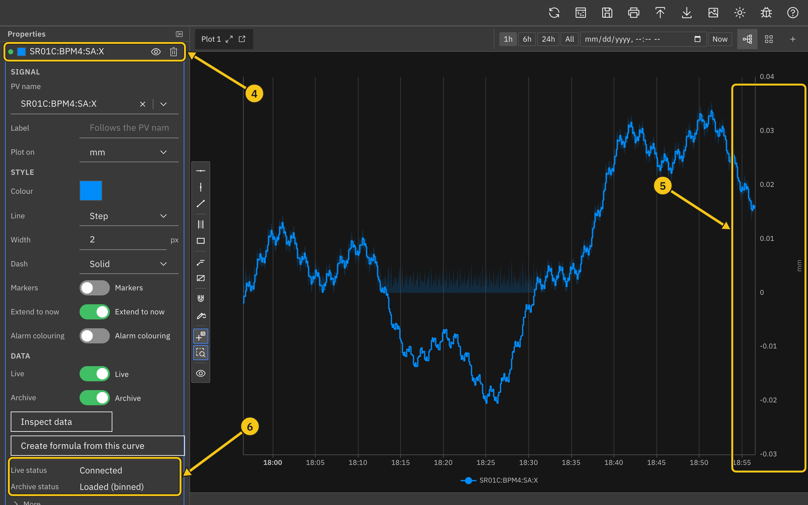</a>

### Add Several PVs at Once

To add many PVs in one go, click the **Search PVs** icon in the header, or the **Search PVs** button below a plot's axes in the **Layers** panel.

1. Type part of a PV name in **Pattern**. Matches from the archiver appear as you type. `*` matches any run of characters and `?` matches one, so `KLYS:LI2*:PDES` finds every PV that starts with `KLYS:LI2` and ends with `:PDES`.
2. Tick the PVs you want, or use **Select all** at the top of the list. Matches are listed alphabetically. Ticks are kept when you change the pattern, so you can gather PVs from several searches; the **Selected** row shows them and lets you remove one or clear them all.
3. Click **Add N PVs**. Double-clicking a match adds it straight away, together with anything already selected.

The new traces appear under the plot's first axis and move to their units axes as the lookups finish (see [Axes and Units](#axes-and-units)). PVs that are already on the plot are marked **on plot**; you can still add them again. The dialog lists at most 500 matches, so narrow the pattern if the PV you want isn't shown. With more than one plot open, the dialog starts on the current plot and **Add to plot** lets you pick another.

### Axes and Units

When you choose a PV, Trace looks up its engineering units and moves the trace to the axis with the same units. If there isn't one, Trace creates a new axis named after the units, alternating between the left and right sides of the plot. Traces with the same units share an axis, so they are easy to compare.

You can always move a trace yourself: pick a different axis from the **Y-Axis** dropdown, or drag the trace onto another axis in the **Layers** panel. The original **Y-Axis 1** stays even when it is empty; click its trash icon to remove it if you don't need it.

_Note: A newly created axis currently starts collapsed in the **Layers** panel. Click the chevron next to the axis name to see its traces._

### Live and Archive Data

**Data sources:**

- **Live Data** — streams new values as they arrive. **Live retention (s)** sets how much live history is kept (default 300 seconds).
- **Archive Data** — loads the plot's time range from the archiver. For ranges longer than 30 minutes, the archiver returns averaged bins, and Trace draws a shaded min/max band behind the line. Turn the band off with **Show min/max band**.

With both on, archive data covers the past and live data takes over from the last archived sample. Each trace uses the plot's **Default Archiver** unless you choose a different one under **Archiver**.

### When a Trace Doesn't Draw

Check the status lines at the bottom of **Data Sources**, or the label next to the trace in the **Layers** panel. Hover over a label to see the full error.

- **Disconnected** (Live Status) — the live connection dropped. Trace reconnects on its own.
- **Waiting for value** (Live Status) — connected, but no value has arrived for this PV yet.
- **Unknown PV** — the archiver has no PV with that name. Check the spelling in **PV Name**.
- **No archiver** — no archiver is set for this plot. Choose one in the plot's **Default Archiver** setting or the trace's **Archiver** setting.
- **Archiver down**, **Timeout**, or **Offline** — the archiver or network isn't responding. Click the refresh icon in the header to try again.

---

## Set the Time Range

Each plot has its own time range. Select **Plot Settings** in the **Layers** panel, then scroll to **X-Axis (Time)** in the **Properties** panel.

**Time settings:**

- **① Time Range** — choose a preset from **Last 1 Hour** to **Last 1 Month**, or **Custom Range...** for fixed start and end times.
- **② Span** — type any length of time, such as `90m`, `1.5h`, or `2w`, and press **Enter**. Units are `m` (minutes), `h` (hours), `d` (days), `w` (weeks), and `M` (months).
- **③ Autoscroll (track now)** — keeps the current time at the right edge of the plot.
- **④ Refresh interval (s)** — how often, from 1 to 60 seconds, the plot moves forward while autoscroll is on.

  <a class="glightbox" href="../images/time_range.png">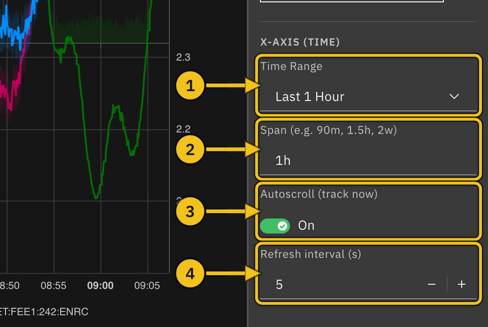</a>

### Custom Range

Choose **Custom Range...**, then set **From** and **To**. Leave **To** blank to end the range at the current time. If the range isn't valid (for example, **From** is after **To**), an error appears below the fields and the plot shows the last hour instead.

### Returning to the Full Range

Autoscroll turns off by itself when you zoom or pan the plot. To return to the full time range and follow the current time again, choose a different **Time Range** or enter a different **Span**. To keep the same range, choose another one and then switch back.

_Note: Switching **Autoscroll** back on, or re-entering the same **Span**, does not undo a zoom or pan. Change the range as described above._

---

## Zoom, Pan, and Read Values

**Mouse controls:**

- **Scroll inside the plot** — zoom the time axis in or out.
- **Drag inside the plot** — move along the time axis.
- **Scroll over a Y-axis** (②) — zoom only that axis, around the mouse pointer.
- **Drag up or down on a Y-axis** — move only that axis.

Zooming or panning time turns off autoscroll (see [Returning to the Full Range](#returning-to-the-full-range)). Zooming or panning a Y-axis switches it from **Auto Scale** to fixed limits; turn **Auto Scale** back on in the axis settings to undo it.

Move the mouse over the plot to see a tooltip (①) with each trace's value at that time. Each value is the sample nearest the pointer, and the time in parentheses shows how far that sample is from the pointer (for example **+2s**). Turn **Show Crosshair** off in **Plot Settings** to hide the dashed crosshair lines; the tooltip still appears.

  <a class="glightbox" href="../images/read_values.png">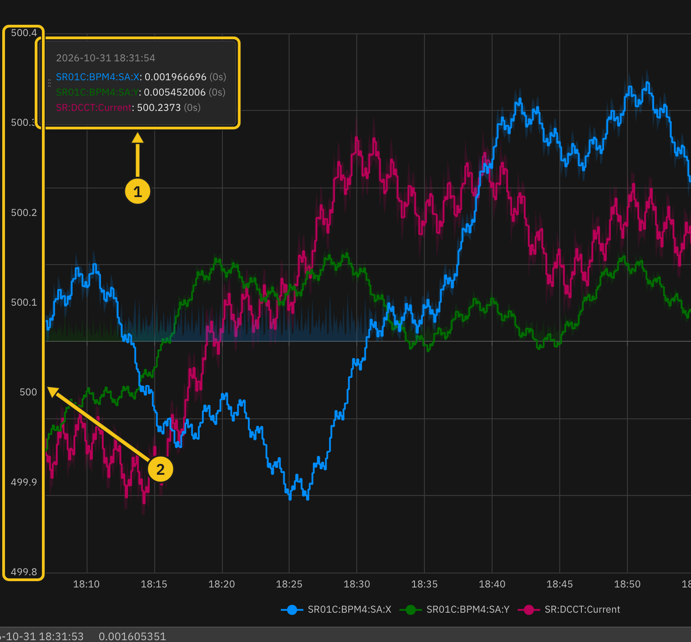</a>

The legend below the plot lists the visible traces. Clicking it doesn't hide a trace; use the **Visible** switch in the trace's settings instead.

---

## Work with Axes

A plot can have several Y-axes, each with its own scale, on the left or right side. Traces with different units usually go on different axes.

**Workflow:**

1. In the **Layers** panel, click **Add Axis** (②) below the plot's axes. New axes alternate between the left and right sides.
2. Click the axis row (①) to open its settings in the **Properties** panel.

**Axis settings:**

- **Label** — the axis name shown in **Layers** and along the axis.
- **Orientation** — **Left** or **Right**.
- **Visible** — show or hide the axis. Hiding an axis also hides its traces.
- **Auto Scale** (③) — fit the axis to the data. Turn it off to set **Min Value** and **Max Value** yourself; they start from the range currently shown.
- **Log Scale** (④) — switch between a linear and a logarithmic scale.

  <a class="glightbox" href="../images/axes.png">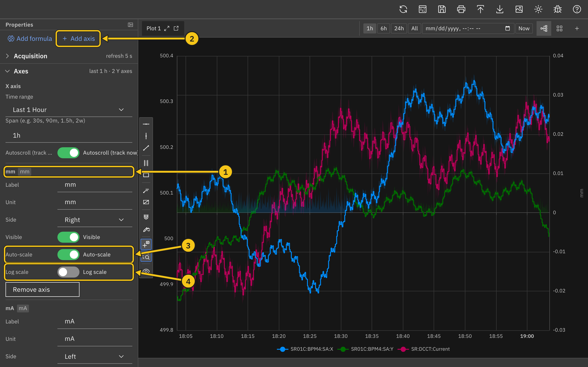</a>

### Move Traces Between Axes

Drag a trace in **Layers** onto another axis, or pick an axis from **Y-Axis** in the trace's settings. In grid view, you can also drag a trace onto an axis in another plot.

### Delete an Axis

Click the trash icon on the axis row. Its traces move to another axis on the same plot. A plot always keeps at least one axis.

_Note: Deleting an axis, trace, or plot happens immediately, without asking for confirmation._

---

## Style Traces

Select a trace in **Layers** to change how it looks. On the **General** tab, **Display Name** sets the name used in the legend, tooltip, and **Layers** (leave it blank to use the PV name), and **Visible** shows or hides the trace.

**Line tab:**

- **① Tabs** — switch between **General**, **Line**, **Symbol**, and **Code**. If the panel is narrow, use the arrow at the end of the tab row to reach **Code**.
- **② Color** — pick a color or type a hex value.
- **Type** — **Step** (holds each value until the next sample; the default) or **Direct** (straight lines between samples).
- **Line Width** — 1 to 5.
- **③ Style** — solid, dashed, dotted, and mixed patterns, or **NoLine** to show only symbols.
- **④ Extend to current time** — draw a dashed line from the last value to the end of the time range.

  <a class="glightbox" href="../images/trace_style.png">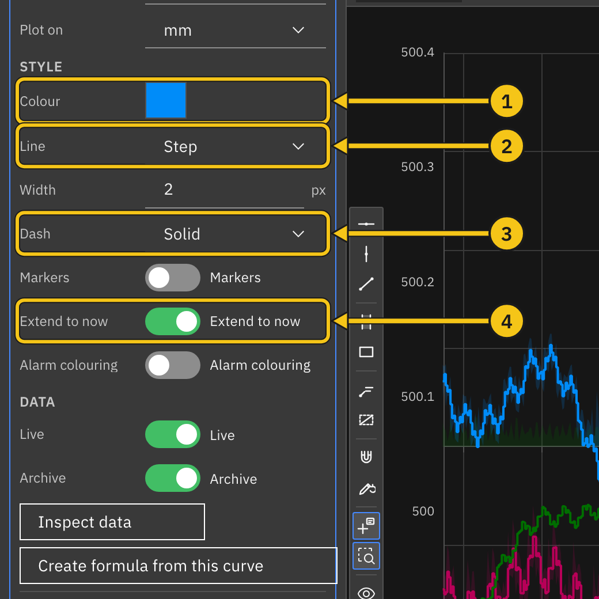</a>

On the **Symbol** tab, turn on **Show Symbols** to mark each sample, then choose a **Shape** and **Size**.

_Note: The **Code** tab is a preview of the chart settings behind the trace. Its **Apply Changes** and **Format** buttons don't do anything yet._

### Color Palettes

New traces get their colors from a palette. Select **Plot Settings** and scroll to **Color Palette**:

- **① Palette** — choose one of 13 palettes. New traces on every plot use it from then on, and Trace remembers your choice.
- **② Apply to all traces** — recolor every trace on this plot from the palette.

  <a class="glightbox" href="../images/palette.png">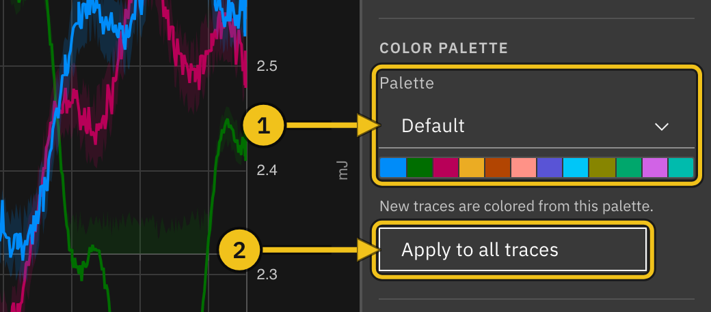</a>

To recolor only one axis's traces, select the axis and use **Apply to this axis** in its **Color Palette** section. Choosing a palette there doesn't change the palette for new traces.

---

## Formulas

A formula curve calculates new values from other traces, for example the ratio of two detectors or a scaled copy of a signal.

**Workflow:**

1. Click **Add Formula** (①) under the axis where the result should appear. The new curve (④) is added to that axis and selected.
2. Enter a **Display Name**.
3. Type an expression in the **Formula** box (②). Refer to other traces with variables in braces, such as `{x1}` and `{x2}`. Trace checks the expression as you type and shows **Valid** or an error.
4. Under **Variables** (③), choose the trace each variable stands for.
5. The curve draws once every variable is bound.

  <a class="glightbox" href="../images/formula.png">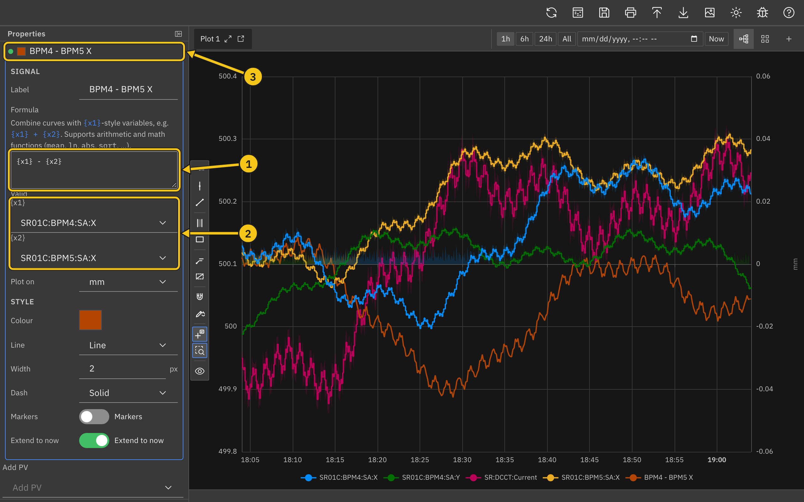</a>

Expressions support arithmetic (`+`, `-`, `*`, `/`, and parentheses) and math functions such as `mean`, `ln`, `abs`, and `sqrt`. For example, `{x1} * 1.5 + 10`.

Formula curves are recalculated whenever the plot's time range moves, including with autoscroll.

### Create a Formula from a Trace

Select a PV trace and click **Create formula from this curve** in the **Derived** section. Trace adds a formula curve with `{x1}` already bound to that trace; edit the expression from there. The original trace is unchanged.

_Note: Variables can refer only to PV traces on the same plot, not to other formulas._

---

## Multiple Plots

Add more plots to view different groups of PVs side by side. Each plot has its own axes, traces, time range, and settings.

**View controls** (①, at the right end of the tab bar):

- **Tab view** — show one plot at a time, with a tab for each plot.
- **Grid view** — show all plots at once.
- **Add plot** (**+**) — add a new, empty plot and switch to it.

**Managing plots:**

- **Rename a plot** — select **Plot Settings** and edit **Title**.
- **Close a plot** — click **×** on its tab, or in the corner of its grid cell. This appears only when there is more than one plot.

In grid view, the **Layers** panel lists every plot, so you can edit any of them and drag traces between plots.

  <a class="glightbox" href="../images/multiple_plots.png">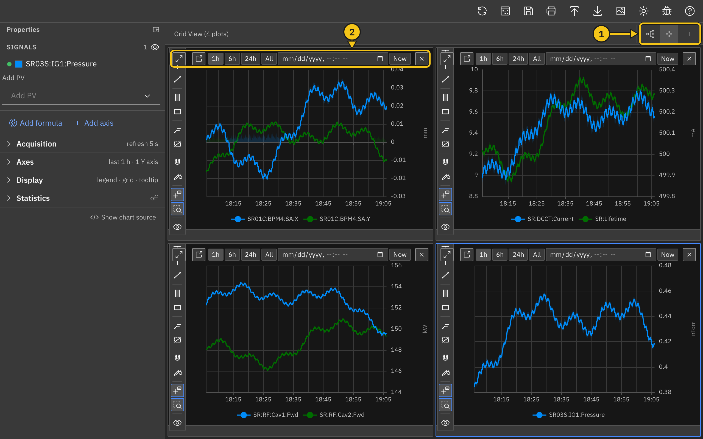</a>

### Fullscreen and Separate Windows

Each plot tab and grid cell (②) has two more buttons:

- **Fullscreen** — show the plot over the whole window. Click **×** in its title bar to return (**Escape** doesn't close it).
- **Detach to window** — move the plot into its own browser window. Useful with a second monitor. Click **Reattach** in that window, or close it, to bring the plot back.

_Note: If your browser blocks pop-up windows, the plot stays in the main window. Allow pop-ups for Trace to detach plots._

---

## Inspect Data

The Data Insight tool lists a PV's samples in a table. Useful when you need exact values and timestamps, or want to export one PV's data.

**Open it by:**

- Clicking the Data Insight icon in the header (++option+d++ on macOS, ++alt+d++ elsewhere)
- Clicking **Inspect data** at the bottom of a trace's **Data Sources** settings

  <a class="glightbox" href="../images/data_insight.png">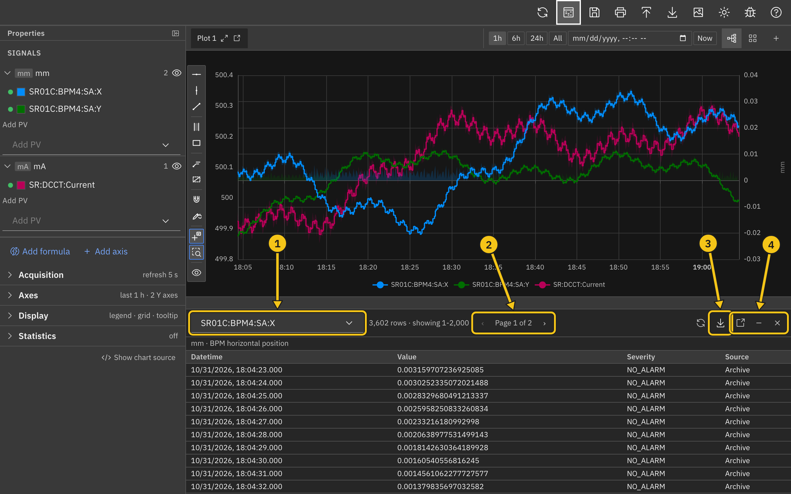</a>

**Controls:**

- **① PV** — choose which PV to inspect. In grid view, the list includes PVs from every plot.
- **② Pages** — the table shows 2,000 rows per page; use the arrows to move between pages.
- **③ Export** — download all rows as **CSV**, **JSON**, or **MAT** (MATLAB). Exports include the PV name, units, and description.
- **④ Pop out, Minimize, Close** — move the tool into its own window, shrink it to a bar below the plot, or close it.

The refresh icon to the left of **Export** loads the data again.

The table covers the plot's current time range and shows each sample's **Datetime** (to the millisecond), **Value**, **Severity**, and **Source** (**Archive** or **Live**). The PV's units and description appear above the table. For very long ranges the archiver may thin out the samples; the row count then shows **(decimated)**.

---

## Save and Open Workspaces

A workspace stores your plots, axes, traces, styles, time ranges, and theme. It doesn't store data; Trace loads the data again when you open the workspace.

- **Save** (++cmd+s++ / ++ctrl+s++) — click the save icon in the header to download the workspace as a `.trc.json` file.
- **Import** (++cmd+o++ / ++ctrl+o++) — click the import icon and choose a workspace file. It replaces whatever is open.

Trace can also open `.trc` files from the older PyDM-based Trace. Settings that have no equivalent are skipped, and Trace lists them in a message after importing.

_Note: Importing replaces the current workspace without asking. Save first if you want to keep it._

---

## Export and Print

- **Export CSV** — downloads one CSV file per plot, named after the plot title. Each row has the PV name, the time (in nanoseconds and as a date), and the value. Archive and formula data are included; traces with only live data are not. For ranges longer than 30 minutes, the archive values are the averaged bins shown on the plot.
- **Export PNG** (++cmd+i++ / ++ctrl+i++) — downloads an image of each plot on screen: the active plot in tab view, every plot in grid view, or the fullscreen plot.
- **Print** (++cmd+p++ / ++ctrl+p++) — prints the plots on screen, arranged in a grid on the page.

Plots detached into separate windows are left out of PNG exports and printouts.

---

## Post to E-Log

Click the E-Log icon in the header (++cmd+e++ / ++ctrl+e++) to post the plots on screen to the E-Log. The icon appears only when Trace is connected to an E-Log.

  <a class="glightbox" href="../images/post_elog.png">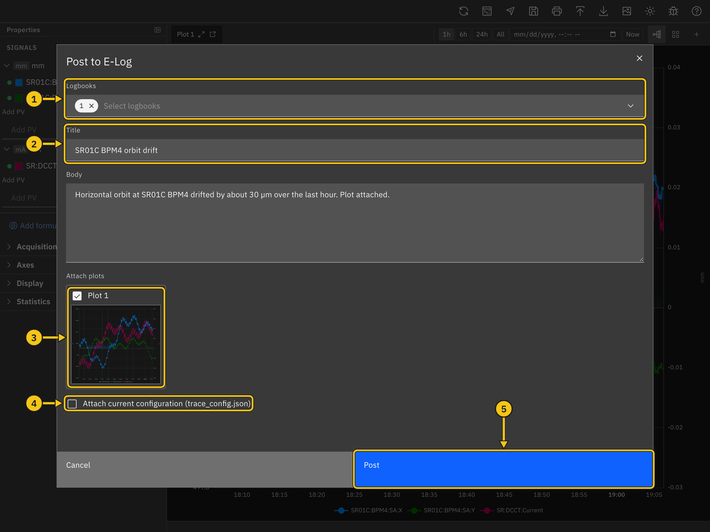</a>

**Workflow:**

1. Choose one or more **Logbooks** (①).
2. Enter a **Title** (②) and, optionally, a **Body**.
3. Under **Attach plots** (③), clear any plot you don't want to include. The images are taken when the dialog opens: the active plot in tab view, or every plot in grid view.
4. Check **Attach current configuration** (④) to add the workspace as `trace_config.json`, so others can open the same view in Trace.
5. Click **Post** (⑤). A message in the top-right corner confirms the new entry.

---

## Keyboard Shortcuts

| Action                 | macOS        | Windows / Linux |
| ---------------------- | ------------ | --------------- |
| Save workspace         | ++cmd+s++    | ++ctrl+s++      |
| Import workspace       | ++cmd+o++    | ++ctrl+o++      |
| Print                  | ++cmd+p++    | ++ctrl+p++      |
| Export PNG             | ++cmd+i++    | ++ctrl+i++      |
| Post to E-Log          | ++cmd+e++    | ++ctrl+e++      |
| Data Insight           | ++option+d++ | ++alt+d++       |
| Switch light/dark mode | ++option+t++ | ++alt+t++       |

Shortcuts don't run while you are typing in a text field.

---

## Icons and Tooltips

Every icon in Trace has a tooltip that appears on hover. Here's a quick reference:

<table style="margin:1.5rem auto; border-collapse:collapse; width:auto;">
  <thead>
    <tr>
      <th style="text-align:center; padding:0.75rem 1.5rem; border-bottom:2px solid #ddd;">Icon</th>
      <th style="text-align:left; padding:0.75rem 1.5rem; border-bottom:2px solid #ddd;">Meaning</th>
    </tr>
  </thead>
  <tbody>
    <tr><td style="text-align:center; padding:0.4rem 1.5rem; vertical-align:middle; border-bottom:1px solid #eee;">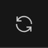</td><td style="padding:0.4rem 1.5rem; vertical-align:middle; border-bottom:1px solid #eee;">Refresh archive data</td></tr>
    <tr><td style="text-align:center; padding:0.4rem 1.5rem; vertical-align:middle; border-bottom:1px solid #eee;">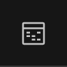</td><td style="padding:0.4rem 1.5rem; vertical-align:middle; border-bottom:1px solid #eee;">Open Data Insight</td></tr>
    <tr><td style="text-align:center; padding:0.4rem 1.5rem; vertical-align:middle; border-bottom:1px solid #eee;"></td><td style="padding:0.4rem 1.5rem; vertical-align:middle; border-bottom:1px solid #eee;">Post to E-Log</td></tr>
    <tr><td style="text-align:center; padding:0.4rem 1.5rem; vertical-align:middle; border-bottom:1px solid #eee;">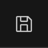</td><td style="padding:0.4rem 1.5rem; vertical-align:middle; border-bottom:1px solid #eee;">Save workspace</td></tr>
    <tr><td style="text-align:center; padding:0.4rem 1.5rem; vertical-align:middle; border-bottom:1px solid #eee;">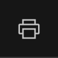</td><td style="padding:0.4rem 1.5rem; vertical-align:middle; border-bottom:1px solid #eee;">Print</td></tr>
    <tr><td style="text-align:center; padding:0.4rem 1.5rem; vertical-align:middle; border-bottom:1px solid #eee;">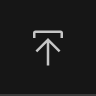</td><td style="padding:0.4rem 1.5rem; vertical-align:middle; border-bottom:1px solid #eee;">Import workspace</td></tr>
    <tr><td style="text-align:center; padding:0.4rem 1.5rem; vertical-align:middle; border-bottom:1px solid #eee;">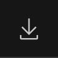</td><td style="padding:0.4rem 1.5rem; vertical-align:middle; border-bottom:1px solid #eee;">Export CSV</td></tr>
    <tr><td style="text-align:center; padding:0.4rem 1.5rem; vertical-align:middle; border-bottom:1px solid #eee;">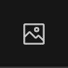</td><td style="padding:0.4rem 1.5rem; vertical-align:middle; border-bottom:1px solid #eee;">Export PNG</td></tr>
    <tr><td style="text-align:center; padding:0.4rem 1.5rem; vertical-align:middle; border-bottom:1px solid #eee;">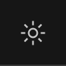</td><td style="padding:0.4rem 1.5rem; vertical-align:middle; border-bottom:1px solid #eee;">Switch between light and dark mode</td></tr>
    <tr><td style="text-align:center; padding:0.4rem 1.5rem; vertical-align:middle; border-bottom:1px solid #eee;">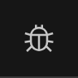</td><td style="padding:0.4rem 1.5rem; vertical-align:middle; border-bottom:1px solid #eee;">Report a bug</td></tr>
    <tr><td style="text-align:center; padding:0.4rem 1.5rem; vertical-align:middle; border-bottom:1px solid #eee;"></td><td style="padding:0.4rem 1.5rem; vertical-align:middle; border-bottom:1px solid #eee;">Open the documentation</td></tr>
    <tr><td style="text-align:center; padding:0.4rem 1.5rem; vertical-align:middle; border-bottom:1px solid #eee;">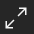</td><td style="padding:0.4rem 1.5rem; vertical-align:middle; border-bottom:1px solid #eee;">Show the plot fullscreen</td></tr>
    <tr><td style="text-align:center; padding:0.4rem 1.5rem; vertical-align:middle; border-bottom:1px solid #eee;"></td><td style="padding:0.4rem 1.5rem; vertical-align:middle; border-bottom:1px solid #eee;">Detach the plot to its own window</td></tr>
    <tr><td style="text-align:center; padding:0.4rem 1.5rem; vertical-align:middle; border-bottom:1px solid #eee;"></td><td style="padding:0.4rem 1.5rem; vertical-align:middle; border-bottom:1px solid #eee;">Close the plot</td></tr>
    <tr><td style="text-align:center; padding:0.4rem 1.5rem; vertical-align:middle; border-bottom:1px solid #eee;">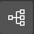</td><td style="padding:0.4rem 1.5rem; vertical-align:middle; border-bottom:1px solid #eee;">Tab view</td></tr>
    <tr><td style="text-align:center; padding:0.4rem 1.5rem; vertical-align:middle; border-bottom:1px solid #eee;">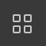</td><td style="padding:0.4rem 1.5rem; vertical-align:middle; border-bottom:1px solid #eee;">Grid view</td></tr>
    <tr><td style="text-align:center; padding:0.4rem 1.5rem; vertical-align:middle; border-bottom:1px solid #eee;"></td><td style="padding:0.4rem 1.5rem; vertical-align:middle; border-bottom:1px solid #eee;">Add a plot</td></tr>
    <tr><td style="text-align:center; padding:0.4rem 1.5rem; vertical-align:middle; border-bottom:1px solid #eee;"></td><td style="padding:0.4rem 1.5rem; vertical-align:middle; border-bottom:1px solid #eee;">Trace uses live data</td></tr>
    <tr><td style="text-align:center; padding:0.4rem 1.5rem; vertical-align:middle; border-bottom:1px solid #eee;"></td><td style="padding:0.4rem 1.5rem; vertical-align:middle; border-bottom:1px solid #eee;">Trace uses archive data</td></tr>
    <tr><td style="text-align:center; padding:0.4rem 1.5rem; vertical-align:middle;"></td><td style="padding:0.4rem 1.5rem; vertical-align:middle;">Delete the trace or axis</td></tr>
  </tbody>
</table>

---

## Dark Mode

Click the sun/moon icon in the header (++option+t++ / ++alt+t++) to switch between dark and light mode. Your choice is saved in the browser and used on future visits. Plots with the default background follow the theme; a plot with a custom **Background Color** keeps it.

---

## Getting Help

Click the bug icon in the header to report a problem or request a feature. See [Support and Contact Information](../index.md#support-and-contact-information) for what to include.
